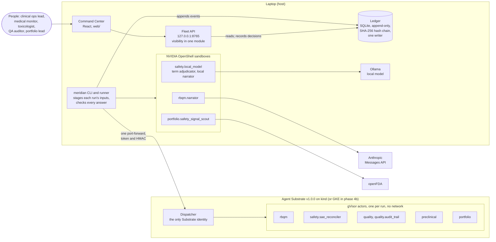

# Meridian Agent Fleet

Meridian Agent Fleet is a learning project. It builds oversight agents for a fictional pharma
company, Meridian Therapeutics, covering the path from a rat toxicology study through a
Phase 2 trial to a portfolio stage gate. The agents compute and cite, and the people decide.
Agents run in sandboxes with no network, and every agent output and every human decision is
an event in an append-only, hash-chained ledger. Each agent is measured against
pre-registered targets, and the misses are recorded as plainly as the passes.

## Contents

- [Who it is for](#who-it-is-for)
- [How it fits together](#how-it-fits-together)
- [The agents](#the-agents)
- [Quickstart: a laptop with kind](#quickstart-a-laptop-with-kind)
- [Running the checks](#running-the-checks)
- [Project status](#project-status)
- [The demo](#the-demo)
- [Documentation](#documentation)
- [License](#license)
- [Honest limits](#honest-limits)
- [Configuration, conventions and layout](#configuration-conventions-and-layout)

## Who it is for

- **Engineers building agents for regulated work.** The project shows one way to put agents
  next to people without letting them decide: containment by infrastructure, a ledger
  that can be verified, and evaluations that state their misses.
- **Clinical development and quality readers.** It shows the oversight work itself:
  risk-based monitoring, SAE reconciliation, TMF completeness, the audit trail, a NOAEL,
  a first-in-human dose, an IND readiness check and a stage gate. Each one is tied to
  the regulation or guidance it comes from.
- **Anyone reviewing it.** Every number in the documents comes from the ledger
  ([docs/project-stats.md](docs/project-stats.md), computed by `meridian stats`) or from
  a phase summary, with the ledger seq it was taken at.

## How it fits together



- **Zones.** Each agent belongs to a zone, and each zone has a policy. The policy says which
  staged data areas the zone may read and which network endpoints, if any, it may reach.
  Six zones have no network and run in Agent Substrate actors. Three zones need one
  endpoint each (the Anthropic API, the local model, openFDA) and run in OpenShell
  sandboxes. The policies are rendered from code, proved against their boundaries, and
  passed conformance in real sandboxes.
- **Executors.** In process (evaluation cuts only), OpenShell, or Substrate. The runner
  refuses any executor other than OpenShell or Substrate for the study's operational data.
- **The dispatcher.** It runs in the cluster and is the only identity that may act on
  actors. It refuses suspend, revert and tag, and holds each pass's inputs in memory only.
- **The ledger.** It stays on the laptop with one writer, the runner. Runs go out in
  parallel, and their events are appended in a fixed order.
- **The Fleet API and the Command Center.** People read findings and record decisions
  through them, under their own (development) identity. Who may see and decide what is one
  rule in `src/meridian/api/visibility.py`.

More detail, and the decisions behind it: [docs/architecture.md](docs/architecture.md).

## The agents

Agents are deterministic unless marked LLM. They raise findings, or for the portfolio
agents reports. People decide the findings.

| Zone | Agent (version) | Executor | What it does | Who decides |
|---|---|---|---|---|
| rbqm | rbqm.kri_monitor 2.2.0 | Substrate | Site key risk indicators (entry lag, query aging, AE rate, deviations) | Clinical ops lead |
| rbqm | rbqm.qtl_detector 2.1.0 | Substrate | Quality tolerance limits on study-wide rates | Clinical ops lead |
| rbqm | rbqm.csm 2.1.0 | Substrate | Central statistical monitoring of vital-sign variance between sites | Clinical ops lead |
| rbqm.narrator | rbqm.narrator 1.1.1 (LLM) | OpenShell, Anthropic API only | Explains a finding in plain language; recorded only if it passes validation | Nobody (information) |
| safety | safety.sae_reconciler 1.1.1 | Substrate | Matches clinical SAEs against the safety database | Medical monitor |
| safety.local_model | safety.term_adjudicator 1.1.1 (LLM) | OpenShell, local model only | Asks two local models whether two terms are one event; answers yes or no only when both agree | Medical monitor |
| safety.local_model | safety.local_narrator 1.0.2 (LLM) | OpenShell, local model only | Explains safety findings with subject ids that never leave the laptop | Nobody (information) |
| quality | quality.tmf_completeness 1.0.0 | Substrate | Is the Trial Master File complete and filed on time | Clinical ops lead |
| quality.audit_trail | quality.audit_trail_reviewer 1.3.0 | Substrate | Reviews the ledger itself: runs without a sandbox, decisions on retired findings, people named outside the API | Clinical ops lead (QA auditor raises observations) |
| preclinical | preclinical.tox_study_monitor 1.1.0 | Substrate | Treatment-related effects in a SEND repeat-dose study (Dunnett, trend tests, deaths and neoplasms as rules) | Toxicologist (the NOAEL is a person's decision) |
| preclinical | preclinical.dose_translation 1.0.0 | Substrate | The first-in-human maximum recommended starting dose by FDA's 2005 method | Medical monitor |
| preclinical | preclinical.ind_readiness 1.0.0 | Substrate | The nonclinical inventory against ICH M3(R2), S7A, S7B, S2(R1) | Portfolio lead (through the gate) |
| preclinical | preclinical.translational_bridge 1.0.0 | Substrate | Target organs to cited Phase 1 monitoring, with safety margins | Medical monitor |
| portfolio_signal | portfolio.safety_signal_scout 1.0.1 | OpenShell, two openFDA paths only | Signals of disproportionate reporting in FAERS, triaged, compared with the US label | Medical monitor |
| portfolio | portfolio.pipeline_intelligence 1.1.0 | Substrate | A PortfolioOutlook per review: status, top 5 risks with seqs, changes | Nobody (information) |
| portfolio | portfolio.stage_gate_pack 1.0.0 | Substrate | An evidence pack per gate request: each criterion met, not met or not applicable; no verdict | Portfolio lead (GateDecision) |

## Quickstart: a laptop with kind

This takes about 30 minutes once Substrate is installed, most of it downloads and the image build. It
runs the operational data cut (DC-BASE) through the agents in Agent Substrate on kind,
records everything in a new ledger, and shows the result in the Command Center.

**You need:** Linux on x86-64, 8 GB of free memory, 30 GB of free disk, git, Docker
(Engine, cgroup v2), [uv](https://docs.astral.sh/uv/), kubectl, Go 1.27 or later, Node.js
22 or later with npm, and network access to github.com, PyPI, npm and the CDISC pilot
files. No sudo is needed. Nothing here creates a cloud resource.

**1. Agent Substrate v1.0.0 on kind.** Follow Substrate's own quickstart at tag `v1.0.0`
([github.com/agent-substrate/substrate](https://github.com/agent-substrate/substrate),
`docs/get-started/quickstart.md`), which needs no sudo. It creates the kind cluster
`kind` (context `kind-kind`), a registry on `localhost:5001`, the `ate-system` namespace
and `kubectl-ate`, and writes its install record to
`~/.cache/ate-setup/installs/kind-kind.yaml`. Then check:

```sh
kubectl --context kind-kind -n ate-system get pods     # Running (and one Completed job)
kubectl ate --version                                   # kubectl-ate version ... v1.0.0
```

**2. Clone and install.**

```sh
git clone https://github.com/bayesianHimanshu/meridian-fleet.git
cd meridian-fleet
uv python install 3.14.10
uv sync
git config core.hooksPath .githooks                     # the project's hooks (this clone only)
```

**3. Data and the ledger.** The CDISC pilot study (public, de-identified) becomes MRD-201,
with synthetic operational, safety and TMF data, all seeded:

```sh
uv run meridian ledger init                  # var/ledger.sqlite3
uv run meridian data fetch                   # the CDISC pilot SDTM files, hash-checked
uv run meridian data ingest --cut DC-BASE    # MRD-201's operational cut, recorded as a DataCut
uv run meridian safety generate              # the synthetic safety database for each cut
uv run meridian tmf generate                 # the synthetic eTMF index for each cut
```

**4. The agent image and the deployment.** Workers run only on a node with the label
`meridian.dev/pool=substrate`, which a new kind install lacks:

```sh
uv run meridian image build                  # docker build from a clean tree; prints the digest
kubectl --context kind-kind label node kind-control-plane meridian.dev/pool=substrate --overwrite
uv run meridian dispatcher token             # the shared token: ~/.config/meridian/dispatcher.token (0600)
uv run meridian substrate deploy             # image to the kind registry, WorkerPool, atespace, templates
uv run meridian dispatcher deploy            # the dispatcher, the only member of the atespace
uv run meridian dispatcher status            # templates with golden snapshots, free workers
uv run meridian substrate conformance        # in a real actor per zone: every egress refused, controls allowed
```

**5. Run the agents and look at the result.**

```sh
uv run meridian agents run                   # every pending (agent, trigger) pair, in Substrate
uv run meridian findings show --cut DC-BASE  # one line per finding
uv run meridian ledger verify                # {"ok": true, ...}
uv run meridian stats --markdown             # the numbers of your ledger
```

**6. The Command Center**, in two terminals from the repository root:

```sh
uv run meridian api serve                    # the Fleet API on http://127.0.0.1:8765
cd web && npm ci && npm run dev              # the Command Center on http://127.0.0.1:5173
```

If port 5173 is taken, run `npm run dev -- --port 5174`; the API stays on 8765. Open the
page and pick a person in the role switcher (development identity, not a sign-in). In the
review queue you will find one finding: site 1008 has more protocol deviations than
expected. That is a known false positive of the operational cut. Record a decision on it,
and the decision becomes a new ledger event under that person.

**Beside another deployment.** To keep a second copy apart from one that is already on the
cluster, give it its own names in a TOML overlay. Then prefix every command with
`MERIDIAN_CONFIG_OVERLAY=<file>`:

```toml
[substrate]
atespace = "meridian-2"
namespace = "meridian-2"
worker_pool = "meridian-2"
dispatcher_namespace = "meridian-2-dispatch"
dispatcher_port = 8091
dispatcher_token_file = "~/.config/meridian-2/dispatcher.token"
```

atenet-router admits exactly one dispatcher, and `dispatcher deploy` sets it to the
dispatcher being deployed. Two copies on one cluster therefore need the router's
`--ingress-allowed-spiffe-ids` to list both, which is a change to ate-system.

**What the quickstart leaves out.**
- **The narrator.** It needs an Anthropic API key in an OpenShell provider
  ([docs/openshell-notes.md](docs/openshell-notes.md)).
- **The local model.** It needs Ollama
  ([docs/local-model-notes.md](docs/local-model-notes.md)).
- **The SEND study and the portfolio.**
  ([docs/commands.md](docs/commands.md), phase 5).
- **The evaluation suites.**
  ([docs/commands.md](docs/commands.md), phase 1).

## Running the checks

```sh
scripts/check.sh            # everything CI runs; non-zero on the first failure (about 20 minutes)
scripts/check.sh --fast     # the pre-commit subset (about 1 minute)
scripts/check.sh --no-web   # the same as the first, without web/
uv run meridian policy prove                  # openshell-prover on every committed policy (CI too)
uv run pytest -m substrate                    # against the kind deployment above
uv run pytest -m openshell                    # needs an OpenShell gateway and the image
```

The full script runs these, and stops at the first failure:
- ruff format --check and ruff check
- mypy --strict (src, tests, scripts)
- pytest without the slow, openshell and substrate marks
- the policy render check
- in `web/`: typecheck, lint, tests and the generated API types check

Two hooks in `.githooks/` run it: pre-commit runs `--fast`, and pre-push runs everything.
They check the working tree, so commit or stash everything first, and never skip them.
CI runs everything on each pull request, plus the policy prover and the production web
build.

## Project status

The project is complete: phases 1 to 5 and a wrap-up. Each phase has a summary covering
what was built, the evidence by ledger seq, the evaluation including the misses, the gaps
and the lessons.

| Phase | What | Summary |
|---|---|---|
| 1 | Three RBQM agents on the CDISC pilot, an append-only ledger, faults, and an honest evaluation; detector recall 0.67 against 0.8 (AE under-reporting undetectable) | [phase1-summary.md](docs/phase1-summary.md) |
| 2 | OpenShell sandboxes, conformance, the policy prover; the narrator, the first LLM use | [phase2-summary.md](docs/phase2-summary.md) |
| 3 | Fleet API and Command Center; SAE reconciliation; a local model; TMF; the audit trail | [phase3-summary.md](docs/phase3-summary.md) |
| 4a | The no-network zones in Agent Substrate on kind, in parallel | [phase4a-summary.md](docs/phase4a-summary.md) |
| 4b | The same zones on GKE behind one in-cluster dispatcher; a full pass of 910 runs in 270 s | [phase4b-summary.md](docs/phase4b-summary.md) |
| 5 | SEND toxicology, the NOAEL as a person's decision, first-in-human dose, IND readiness, the signal scout, the portfolio outlook and stage gate | [phase5-summary.md](docs/phase5-summary.md) |

**Phase 5 status:** complete. The NOAEL was decided by the toxicologist, the starting dose
of 1.94 mg was accepted by the medical monitor, and the deaths PRE-0221 and PRE-0222 were
accepted by the toxicologist. The portfolio lead recorded a conditional go on MRD-101's
IND gate (seq 20158), with five conditions. Details are in
[docs/phase5-summary.md](docs/phase5-summary.md).

**Wrap-up:** the numbers are in [docs/project-stats.md](docs/project-stats.md) (ledger seq
20158, verified). The one-page summary is [docs/project-summary.md](docs/project-summary.md),
and the open items are in [docs/backlog.md](docs/backlog.md).

## The demo

**Watch it:** https://bayesianhimanshu.github.io/meridian-fleet/

- **What it is.** A narrated video of the Command Center (7 min 30 s, 10 chapters), on a
  page where you watch it and ask questions. Answers come by retrieval from the transcript
  and these documents.
- **How it was recorded.** Against a verified copy of the ledger, through the API in a
  read-only mode that refuses every write. One write attempt during the recording, as an
  operator, was refused with 403.
- **Where the video lives.** It is never committed. It is an asset of the GitHub release
  v1.1.0 (https://github.com/bayesianHimanshu/meridian-fleet/releases/tag/v1.1.0), with its
  captions, the transcript and an offline zip. The Pages workflow
  (.github/workflows/pages.yml) assembles the site from that release.
- **More.** How to record it, the versions and voice used, how the question box was
  evaluated, and how it is published: [docs/demo/README.md](docs/demo/README.md). Script:
  [docs/demo/script.md](docs/demo/script.md).

**This repository.** The project was developed in a private repository. This public one
starts at v1.1.0 as a single commit. The development history (phases 1 to 5, the wrap-up and
the demo) is summarised in [docs/project-summary.md](docs/project-summary.md) and the phase
summaries, with ledger seqs for every number.

## Documentation

Start here:
- [docs/project-summary.md](docs/project-summary.md): the project on one page
- [docs/architecture.md](docs/architecture.md): the design, the decisions behind it, and
  where it differs from the plan
- [docs/lessons.md](docs/lessons.md): the lessons across all phases, each with the
  incident that taught it
- [docs/backlog.md](docs/backlog.md): open items, why each matters, and a first step
- [docs/project-stats.md](docs/project-stats.md) ([JSON](docs/project-stats.json)): the
  numbers from the ledger
- [docs/commands.md](docs/commands.md): the command reference, phase by phase

Phase summaries: [1](docs/phase1-summary.md), [2](docs/phase2-summary.md),
[3](docs/phase3-summary.md), [4a](docs/phase4a-summary.md), [4b](docs/phase4b-summary.md),
[5](docs/phase5-summary.md).

| Area | Documents |
|---|---|
| Data | [data-notes.md](docs/data-notes.md) (CDISC pilot to MRD-201), [preclinical-data.md](docs/preclinical-data.md) (the public SEND study) |
| RBQM (phase 1) | [rbqm-notes.md](docs/rbqm-notes.md), [calibration-step3.md](docs/calibration-step3.md), [tuning-phase1.md](docs/tuning-phase1.md), [eval-phase1.md](docs/eval-phase1.md), [ae-experiment.md](docs/ae-experiment.md) |
| Containment (phase 2) | [openshell-notes.md](docs/openshell-notes.md), [threat-model.md](docs/threat-model.md) |
| Narrator (phase 2) | [narrator-eval.md](docs/narrator-eval.md), [narrator-labels.md](docs/narrator-labels.md) |
| API and review (phase 3) | [api-notes.md](docs/api-notes.md) |
| Safety (phase 3) | [safety-notes.md](docs/safety-notes.md), [safety-eval.md](docs/safety-eval.md), [local-model-notes.md](docs/local-model-notes.md), [local-model-eval.md](docs/local-model-eval.md) |
| Quality (phase 3) | [tmf-notes.md](docs/tmf-notes.md), [tmf-eval.md](docs/tmf-eval.md), [audit-notes.md](docs/audit-notes.md), [audit-eval.md](docs/audit-eval.md) |
| Agent Substrate (phase 4) | [substrate-design.md](docs/substrate-design.md), [substrate-eval.md](docs/substrate-eval.md), [gke-plan.md](docs/gke-plan.md), [gke-session.md](docs/gke-session.md), [input-staging.md](docs/input-staging.md) |
| Preclinical (phase 5) | [preclinical-notes.md](docs/preclinical-notes.md), [preclinical-eval.md](docs/preclinical-eval.md), [noael-decision.md](docs/noael-decision.md), [noael-assessment-MRD-101-TOX-01.md](docs/noael-assessment-MRD-101-TOX-01.md), [fih-dose-notes.md](docs/fih-dose-notes.md), [ind-readiness-eval.md](docs/ind-readiness-eval.md), [translational-notes.md](docs/translational-notes.md) |
| Portfolio (phase 5) | [signal-scout.md](docs/signal-scout.md), [stage-gate-notes.md](docs/stage-gate-notes.md) |
| API contract | [openapi/meridian-api.json](openapi/meridian-api.json) |

## Honest limits

- **Synthetic and public data only.** MRD-201 is the public CDISC pilot study, de-identified,
  with seeded synthetic operational, safety and TMF data. MRD-101's toxicology study is
  instem's public SEND sample. The signals come from public FAERS data through openFDA.
  Meridian Therapeutics, its assets and its people are fictional.
- **Not a validated GxP system.** Nothing here has been validated under 21 CFR Part 11,
  EU Annex 11 or GAMP 5. The hash-chained ledger shows tampering after the fact, but it is
  not an electronic-signature system, and the stress sets are specification tests written
  by the same author as the agents.
- **Development identity only.** The Fleet API trusts the person and role headers it is
  sent (config/people.toml). Anyone who can reach 127.0.0.1:8765 can claim any listed
  person. There is no authentication and no sign-in.
- **A laptop project.** The ledger lives on one machine with one writer. GKE ran for two
  sessions in phase 4b and was then torn down.
- **Agents are not people.** No agent decides anything. An agent's finding, pack or
  outlook is information until a named person records a decision, and the misses in each
  phase summary show why that matters.

## Configuration, conventions and layout

- **Configuration.** Settings come from `config/default.toml`. An environment variable
  prefixed `MERIDIAN_` overrides one setting (for example
  `MERIDIAN_LEDGER_PATH=/tmp/l.sqlite3`; nested keys use `__`, such as
  `MERIDIAN_SUBSTRATE__ATESPACE`). `MERIDIAN_CONFIG_OVERLAY` merges another TOML file over
  the defaults.
- **Append-only.** Ledger events, cuts, ground truth and scorecards are written once.
- **Determinism.** Time comes from an injected Clock, and randomness from seeded numpy
  Generators. Every polars `group_by` that feeds a computation keeps its order;
  `tests/contract/test_group_by_order.py` enforces this.
- **Identity.** People act only through the Fleet API. The CLI and the runner record an
  operator (`operator:<os user>`), an agent or a system id, never a person.

```
src/meridian/
  domain/     pure Pydantic v2 types (imports nothing outside domain)
  ledger/     canonical JSON, the SHA-256 chain, the SQLite store, the verifier
  data/       CDISC and SEND readers, cut writer, staged readers per zone
  faults/     fault catalog and injector (never imported by agents)
  agents/     agent protocol, registry, runner; rbqm, safety, quality, preclinical, portfolio
  stats/      the statistics shared by agents and evals
  evals/      matching, metrics, scorecards (never imports agents)
  sandbox/    staging, policies, the image, executors (in process, OpenShell, Substrate,
              dispatcher), conformance, leak check
  api/        the Fleet API: repository, visibility, routes
  platform/   Clock, Settings, Container
  cli*.py     the `meridian` command; worker.py and dispatcher_serve.py run in sandboxes
web/          the Command Center (React, generated API types)
policies/     one OpenShell policy per zone (rendered, committed, proved)
deploy/       Substrate templates and WorkerPool, the dispatcher, GKE scripts
scripts/      evaluations, stress sets, project stats (nothing in src imports them)
tests/        unit, property, contract, api, slow, openshell and substrate tests
```

## License

Apache License 2.0: [LICENSE](LICENSE), with attributions in [NOTICE](NOTICE) and
[docs/third-party.md](docs/third-party.md).

The Apache License 2.0 covers this project's code and documentation. It does not cover the
CDISC pilot data or values derived from it, which remain under CDISC's terms; meridian data
fetch downloads the data from CDISC's repository. Study MRD-201 is derived from the CDISC
SDTM/ADaM Pilot Project data (CDISCPILOT01), relabelled and with synthetic additions, used
under CDISC's terms of use. It is not a real study, and this project is not affiliated with
or endorsed by CDISC.
